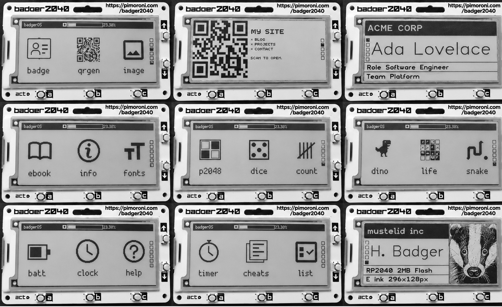
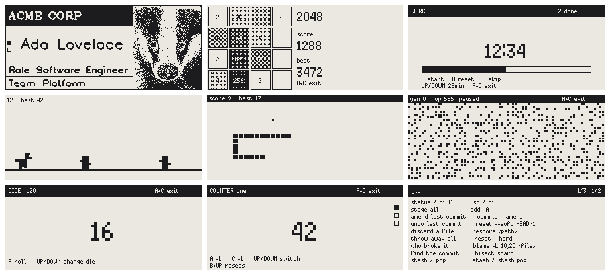

# badger2040

[](https://github.com/atahan99/badger2040/actions/workflows/test.yml)
[](LICENSE)

Apps for the [Pimoroni Badger 2040](https://shop.pimoroni.com/products/badger-2040),
the non-wireless model. Everything runs on battery with no computer attached:
flash it once, deploy once, unplug it.



## Apps



Written for this project:

| App | What it does | Buttons |
|---|---|---|
| `badge` | Name badge with any number of profiles in `/badges` | UP/DOWN cycle profiles |
| `batt` | Battery voltage and percentage | A re-read |
| `cheats` | Reference cards from `/cheats/*.txt` | UP/DOWN sheet, A/C page |
| `count` | Three tally counters that survive power-off | A +1, C −1, UP/DOWN switch, B+UP reset |
| `dice` | Coin, d4 to d20, yes/no | A roll, UP/DOWN change die |
| `dino` | Endless runner, jump the cacti | UP jump (hold it, the e-ink runs at about 4 fps), B restart |
| `life` | Conway's Game of Life on a wrapping grid | A run/pause, B reseed, C step |
| `p2048` | 2048 | UP/DOWN/A/C slide, B new game |
| `snake` | Snake, walls are fatal | UP/DOWN/A/C steer, B start |
| `timer` | Pomodoro: 25/5, long break every 4th | A start/pause, B reset, C skip, UP/DOWN length |

These ship with the firmware and are unchanged: `qrgen` (a QR deck for a contact
card, links and guest wi-fi), `list` (checklist), `ebook`, `image`, `help`,
`info`, `fonts` and `clock`. The clock can't keep time, because the board has
no clock chip.

## How it works

To last on two AAA cells, an app calls `halt()` as soon as it has drawn. That
cuts the 3V3 rail, so the RP2040 switches off while the e-ink keeps showing the
last frame at no cost. A button press powers the board back on, which makes
every press a cold boot:

```
power on ─► main.py ─► launcher ─► badger_os.launch(app)
                ▲                         │
                │   button press = boot   │  load /state/<app>.json
                └── halt() cuts power ◄───┘  apply the wake press, draw once, save
```

Nothing survives in memory. A 2048 board, a paused timer or a Life grid lives
in the app's state file. On each boot the app loads that file, applies the
button that woke it, and draws once, so a press costs one e-ink refresh.
`tools/test_sleep.py` checks this on the desktop by booting each app against a
fake `badger2040` with saved state and a wake button.

## Buttons

There are five front buttons (UP, DOWN, A, B, C) and BOOT/USR on the back.

| Press | Does |
|---|---|
| **A + C together** | **Quit any app, back to the menu.** There is no home button |
| A / B / C in the menu | Open the app in the left / middle / right column |
| UP / DOWN in the menu | Change page |
| BOOT/USR held while plugging in | Mounts as `RPI-RP2` for reflashing |

A press both wakes the badge and counts as input, so the screen takes a moment
to change while the board boots. Turning the power on lands on the menu; waking
a sleeping app returns you to that app.

Eighteen apps, three per page:

| Page | | | |
|---|---|---|---|
| **1** essentials | `badge` | `qrgen` | `image` |
| **2** games | `dino` | `life` | `snake` |
| **3** games | `p2048` | `dice` | `count` |
| **4** desk tools | `timer` | `cheats` | `list` |
| **5** status | `batt` | `clock` | `help` |
| **6** reading, system | `ebook` | `info` | `fonts` |

The order comes from the `ORDER` list in `launcher.py`. The stock launcher
sorts alphabetically, which buries the useful apps. Apps missing from `ORDER`
still appear at the end. Names stay short because the launcher gives each label
about 106 px.

## Hardware

| Part | Notes |
|---|---|
| [Badger 2040](https://shop.pimoroni.com/products/badger-2040) | The non-W board: RP2040, 2 MB flash, 296×128 e-ink. No wi-fi, no clock chip |
| [2×AAA battery holder with switch](https://shop.pimoroni.com/products/battery-holder-2-x-aaa-with-switch) | With the switch on, the badge stays powered when unplugged, which can make USB look broken |
| [Case for Pimoroni Badger 2040](https://makerworld.com/en/models/850255-case-for-pimoroni-badger-2040) | 3D printed, from MakerWorld |

Docs: [getting started](https://learn.pimoroni.com/article/getting-started-with-badger-2040#using-badger-os)
· [customising the examples](https://learn.pimoroni.com/article/getting-started-with-badger-2040#customising-the-badgeros-examples)
· [pimoroni/badger2040](https://github.com/pimoroni/badger2040)
· [API reference](https://github.com/pimoroni/badger2040/blob/main/docs/reference.md)

## Setup

**1. Flash.** The board ships with a 2022 image that is too old for these apps.
From [Pimoroni's releases](https://github.com/pimoroni/badger2040/releases), get
the non-W `pimoroni-badger2040-v0.0.5-micropython-with-badger-os.uf2`
(MicroPython 1.23.0, the version these apps are tested on). Hold BOOT/USR while
plugging in and drop the file on the `RPI-RP2` drive. From a shell, use
`cp -X`: without it, macOS reports an extended-attribute error even though the
image copied fine. Flashing wipes the filesystem.

**2. Add your content.**

```bash
cp badges/01-work.txt.example badges/01-work.txt
```

A badge file has 7 lines: company, name, detail 1 title, detail 1 text,
detail 2 title, detail 2 text, and an optional image path (leave it blank for
text only). A QR file is the payload, a title, then body text. A cheat sheet is
a title, then the body.

For a photo badge, `python3 tools/make_photo.py me.jpg badges/photo.png` crops
the photo to 104×128 and dithers it to 1-bit.

**3. Deploy.** Run `pip install mpremote`, then replug the badge and run this
within a few seconds:

```bash
tools/deploy.sh
```

An idle badge cuts its own power, so `deploy.sh` stops before copying anything
if it can't reach the board. Replug and run it again; repeating it is safe.

## Your data stays out of git

`.gitignore` excludes `badges/*.txt`, `badges/*.png|jpg` and `qrcodes/*.txt`,
so only the `*.txt.example` templates are committed. Your own profiles live in
the same checkout as the code. `deploy.sh` copies them and skips the templates.
It also deletes the firmware's sample badge and QR, so those don't show up
next to yours.

Anyone holding the badge can read what's on it. The wi-fi QR contains its
password, so use a guest network, and an emergency profile shows its details to
whoever picks the badge up.

## Working on the badge

```bash
python3 tools/test_logic.py       # game rules, on the desktop
python3 tools/test_sleep.py       # state survives halt(), one refresh per press
tools/run_on_device.sh            # every app, on real hardware
python3 tools/screenshot.py       # docs/images/*.png from the badge's framebuffer
tools/dev_mode.sh on|off|status   # park main.py so the badge stops sleeping
python3 tools/make_icons.py       # regenerate launcher icons
```

Because `halt()` switches the RP2040 off, a sleeping badge drops off USB and a
button press wakes the screen, not the serial link. You can only reach it in
the few seconds after a replug. `dev_mode.sh on` parks `main.py` so the badge
stays at the REPL while you work; run `dev_mode.sh off` when you're done.

Use plain `mpremote` for the first command, because its soft reset can break
into a running app. Use `mpremote resume` for every command after that: it
skips the reset, so the board doesn't reboot into the launcher and fall asleep.
Mixing these up makes the board look dead. Don't kill `mpremote` in the middle
of a transfer, because that leaves the macOS serial port stuck.

**Never call `badger2040.system_speed(SYSTEM_TURBO)`.** It sets 250 MHz without
raising the core voltage, and the chip locks up with no display, buttons or
USB until you cut the power. `UPDATE_TURBO` is a separate, safe setting, and
the e-ink refresh limits the frame rate anyway.

Each app keeps its hardware-free logic above a `# --- hardware below ---`
marker. `test_logic.py` runs only that part, so the tests use the real rules
and need no `badger2040` stub. `test_sleep.py` runs the whole app against a
small fake. CI runs both tests and `ruff`.

`screenshot.py` runs each app once on the badge with drawing sent to a buffer
(`set_framebuffer`) instead of the e-ink, so the images match the screen pixel
for pixel. App state comes from fixtures in the script, so your profiles, QR
codes and scores are never read.

## What is patched

Two files come from upstream with local changes, explained in their comments:

- `launcher.py`: stock, plus the `ORDER` list for page layout.
- `main.py`: opens the menu on power-on instead of reopening the last app. The
  `woken_by_button()` check keeps that to real power-ons; without it, every
  button press inside an app would send you back to the menu.

## Credits

Code written here is [MIT](LICENSE).

Built on [pimoroni/badger2040](https://github.com/pimoroni/badger2040), MIT
(© 2023 Pimoroni Ltd). `launcher.py` and `examples/badge.py` are based on it and
stay under that licence, included at
[licenses/pimoroni-badger2040-LICENSE](licenses/pimoroni-badger2040-LICENSE).
The stock apps ship with the firmware and are not included here.

`dino` was inspired by
[niutech/dino-badger2040](https://github.com/niutech/dino-badger2040). That
repo has no licence, so no code was copied from it.
